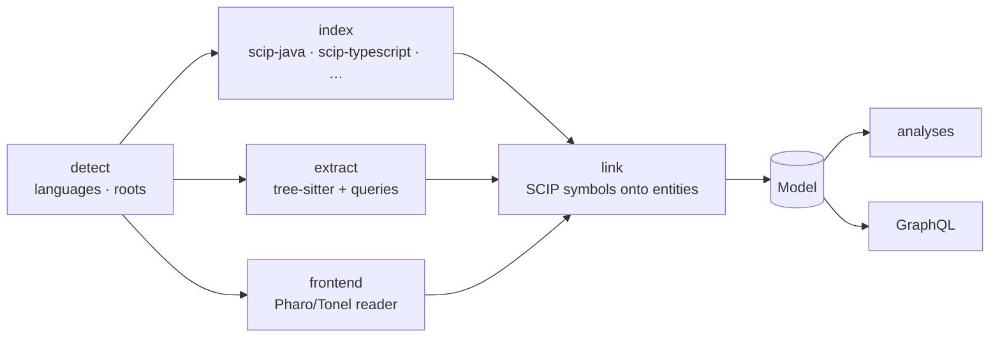

<p align="center">
  
</p>

<h1 align="center">Model</h1>

<p align="center"><strong>A language-neutral model of your codebase.</strong></p>

<p align="center">
Syntax from <a href="https://tree-sitter.github.io/">tree-sitter</a>, resolved
symbols from <a href="https://github.com/sourcegraph/scip">SCIP</a>: one graph
that every analysis and plugin can share — whatever the language.
</p>

<p align="center">
  <a href="https://github.com/badetitou/Model/actions/workflows/ci.yml"></a>
  <a href="https://crates.io/crates/model-factory"></a>
  <a href="https://github.com/badetitou/Model/tree/main/crates"></a>
  <a href="https://github.com/badetitou/Model/blob/main/rust-toolchain.toml"></a>
  <a href="https://github.com/badetitou/Model/blob/main/LICENSE"></a>
</p>

Model builds **one model per codebase, not one per language**. Java, TypeScript,
Python and Pharo sources land in the same graph of entities and relations, and
so will every future language: detection, indexing and extraction are
data-driven. A language usually is a grammar, a query file and a row in a table;
when neither grammar nor indexer exists, a direct frontend fills the same
builder.

```
Namespace ⊃ Class ⊃ Method
                    ├── calls ─────► Method
                    ├── references ► Field
                    └── implements ► Interface
```

<p align="center"><sub>
<a href="#highlights">Highlights</a> ·
<a href="#how-it-works">How it works</a> ·
<a href="#quick-start">Quick start</a> ·
<a href="#use-it-as-a-library">Library</a> ·
<a href="#crates">Crates</a> ·
<a href="#languages">Languages</a> ·
<a href="#numbers">Numbers</a> ·
<a href="#graphql-in-action">GraphQL</a> ·
<a href="#development">Development</a> ·
<a href="#documentation">Documentation</a> ·
<a href="docs/usage.md">Usage guide</a> ·
<a href="docs/examples.md">Examples</a> ·
<a href="docs/on-demand.md">On-demand import</a>
</sub></p>

## Highlights

- **Nothing to configure.** Languages, file counts and project roots are
  detected from the tree, `.gitignore` included. Monorepos just work.
- **Best of both worlds.** tree-sitter gives fast, error-tolerant syntax and
  exact extents; SCIP indexers give compiler-grade symbol resolution. One
  without the other is a supported, first-class mode.
- **Every occurrence is kept.** A relation is unique per
  `(from, kind, to, provenance)` and stores *all* its sites, so dependency
  weight, impact of a diff or a heat map needs no re-parse.
- **Compact and fast.** ~43 bytes per site all included (range + 1-byte flags), 5M sites in ~200 MiB;
  reads borrow the model and never allocate.
- **Stable identity.** Entities are keyed by SCIP symbols (or SCIP-like keys for
  languages without an indexer), so two builds are comparable.
- **Straight into Pharo.** A Pharo image can load a model into Moose through
  UFFI, from a `model.json` or from the sources, with no Moose JSON round trip:
  3.5 to 4x faster than the Moose JSON import on `java/util` (see
  [below](#moose-from-pharo-without-json)).
- **Batteries included.** GraphQL server with GraphiQL, JSON export, a git-blob
  keyed document cache that rebuilds an index without running the indexer.

## How it works



1. **Detect** — scan the tree, count source files, find project roots (build
   markers such as `pom.xml`, `package.json`, `Cargo.toml`…).
2. **Index** — run (or reuse) the SCIP indexer of each project, with staleness
   policies, timeouts, progress and a per-document cache.
3. **Extract** — tree-sitter queries produce entities, extents, containment and
   language-specific props. Relations are resolved by name when no index exists.
3b. **Frontend** — languages without a grammar are read directly; Pharo/Tonel
   classes, methods and hand-resolved message sends feed the same builder with
   `Provenance::Frontend`.
4. **Link** — SCIP definitions are matched to syntax entities (rekeyed to the
   SCIP symbol); references become `calls`, `references` and `imports` with every
   site, `Provenance::Scip`.

Failures are warnings, never dead ends: no indexer → syntactic relations; no
grammar → SCIP-only model; neither → a direct frontend may still model the
language (Pharo), otherwise the other languages are modelled.

## Quick start

<p align="center">
  
</p>

<p align="center"><sub>
Model on Structure's <code>jpetstore</code> fixture: 46 Java files, already indexed by
scip-java. Regenerate the recording with <code>vhs docs/demo.tape</code>.
</sub></p>

```sh
git clone https://github.com/badetitou/Model && cd Model
# to build exactly the 0.5.0 release: git checkout v0.5.0
```

**Try it on the bundled sample** (8 Java files, no indexer needed — the other
scenarios of [docs/examples.md](docs/examples.md) use the same project):

```sh
cargo run -p model-factory --example tour
```

It builds the model of [`docs/examples/shop`](docs/examples/shop), queries it by
kind and relation, runs the analyses and rebuilds incrementally.

**Build the model of any project** — and see what it holds:

```sh
cargo run --release -p model-factory --example build -- ../Structure
```

Example output on jpetstore (46 Java files):

```
language java — 46 files, project roots ["."]
tree-sitter java (46 files, 571 definitions, 0 unresolved): relations from SCIP
scip-java in . (reused): 0 created, 94.5% mapped (100.0% with lifting), 5671 sites
978 entities (141 types, 525 callables, 352 external)
3861 relations, 5671 sites, 0.4 MiB, languages ["java"], in 51.4 ms
```

Useful flags:

| Flag | Effect |
|---|---|
| `--reindex never \| if-missing \| if-stale \| always` | when to run indexers (default: `never`) |
| `--no-scip` | tree-sitter only: entities + best-effort relations |
| `--from-cache` | compose the index from cached documents instead of running the indexer |
| `--no-cache` | do not read or write the document cache |
| `--fragment-cache <dir>` | keep the per-file fragment cache in `<dir>` instead of the repository |
| `--index-command LANGUAGE=COMMAND` | your own command produces the index of a language (also `MODEL_INDEX_COMMAND`); see [usage](docs/usage.md) |
| `--json model.json` | export the model |

**Explore it over GraphQL** (GraphiQL included):

```sh
cargo run --release -p model-graphql -- ../Structure --reindex if-stale
# GraphiQL on http://127.0.0.1:8000/ , API on /graphql
```

The server also accepts an exported `model.json` instead of a source root,
`--schema` prints the SDL of the model it would serve, and `--on-demand`
(with `--package <dir>` or `--diff <base>`) builds nothing up front: each query
decides which layers run ([on-demand import](docs/on-demand.md)). Introspection is enabled (GraphiQL uses it). For a
browser client on another origin — e.g. Fluid on `http://localhost:5173` —
allow it explicitly:

```sh
cargo run --release -p model-graphql -- ../Structure \
  --allow-origin http://localhost:5173
```

`--allow-origin` is repeatable, accepts comma-separated origins, and `*` allows
any origin. Without it, no CORS header is sent.

## Use it as a library

```toml
[dependencies]
model-factory = "0.5.0"
```

```rust
let build = model_factory::build(root, &model_factory::BuildOptions::default(), &|p| {
    eprintln!("[{:>3}%] {}", p.pct, p.step);
})?;
for w in &build.warnings {
    eprintln!("warning: {w}");
}

let model = build.model;
let svc = model.by_key("semanticdb maven maven/org.acme/app 1.0 com/acme/AccountService#")
    .expect("AccountService is indexed");

for r in svc.outgoing() {
    println!("{:?} {} ({} sites)", r.kind(), r.to().key(), r.sites().len());
}
```

Need finer control? Every crate is re-exported (`model_factory::core`, `model_factory::detect`,
`model_factory::index`, `model_factory::scip`, `model_factory::link`, `model_factory::treesitter`), so you can
build a model from an index alone:

```rust
use std::path::Path;

let index = model_factory::scip::load(Path::new("index.scip"))?;
let (mut builder, stats) = model_factory::link::from_scip(&index, None);
println!("{} calls, {} imports", stats.calls, stats.imports);
let model = builder.build();
```

### Navigating a model

`Model` exposes `entity(id)`, `by_key(key)`, `entities()`, `of_kind(kind)`,
`of_kind_id(id)`, `of_trait(mask)`, `metamodel()`, `roots()`, `relations()`,
`languages()` and `memory()`.
`EntityRef` gives `key`, `kind`, `kind_id`, `kind_name`, `has_trait`, `name`,
`language`, `external`, `file`, `range`, `props`, `parent`, `ancestors`,
`children`, `outgoing`, `incoming` and `targets(kind)`; `RelationRef` gives
`kind`, `from`, `to`, `provenance`, `sites` and `site_flags`. Lookups return `Option` or iterators; nothing panics.

```rust
use model_factory::{EntityKind, Model, RelationKind};

fn print_call_counts(model: &Model, class_name: &str) {
    let Some(class) = model.entities().find(|e| e.name() == class_name) else {
        return;
    };
    for method in class.children().filter(|e| e.kind() == EntityKind::Method) {
        let sites: usize = method
            .incoming()
            .filter(|r| r.kind() == &RelationKind::Calls)
            .map(|r| r.sites().len())
            .sum();
        println!("{} — {sites} call site(s)", method.name());
    }
}
```

## Moose from Pharo, without JSON

[`model-ffi`](crates/model-ffi) exposes a frozen `Model` as flat arrays over a
C ABI; the Pharo package [`Model-Moose-Importer`](pharo/README.md) reads them
through UFFI and creates the FamixJava objects directly. Two entry points: a
`model.json`, or the sources themselves (library built with
`--features build`, the model is built in-process and no file is written).

```bash
cargo build --release -p model-ffi --features build
```

```smalltalk
ModelLibrary libraryPath: '/path/to/target/release/libmodel_ffi.dylib'.
ModelImporter new
	prefix: 'FamixJava';
	importSourcesAt: '/path/to/sources' into: FamixJavaModel new.
```

On `java/util` of the JDK (370 files, 65 k entities, 122 k sites), same image:

| Path | Time |
|---|---|
| Moose JSON (`importFromJSONStream:`) | 8.7 s |
| `model.json` through `model-ffi` | 2.3 s |
| From the sources, in one call (build included) | 2.5 s |

Typings, accesses, invocations and references match the JSON import exactly;
the remaining differences (file comments, `Parametric*` classes, implicit
`self`) and what is not done yet are listed in the
[importer README](pharo/README.md#parity-with-the-json-import). Only FamixJava
has been tried.

## The metamodel

```
Entity
  id          dense index, local to the model
  key         stable identity: SCIP symbol or SCIP-like key
  kind        Namespace | File | Class | Interface | Trait | Enum | Struct
              | TypeAlias | Method | Constructor | Function
              | Field | Property | Constant | Variable   (the 15 archetypes)
  kind_id     fine kind, a row of the model's Metamodel: `record`, `parameter`,
              `local_variable`, `ts.interface`... with its archetype, traits
              and optional GraphQL concept names
  name        simple name
  parent      containment (Namespace ⊃ Type ⊃ Method …)
  language    open id: "java", "typescript", "python"…
  external    referenced but not defined in the sources
  file, range, name_range
  props       open map: "java.annotations", "visibility", "http.endpoints"…

Relation
  kind        Calls | References | Inherits | Implements | Imports
              | DeclaredType | Accesses | Throws | Overrides | Other(String)
  from, to    entities
  provenance  TreeSitter | Scip | Frontend | Derived
  sites       every occurrence range, in from's file, each with a flag byte
              (READ / WRITE / RECEIVER for `accesses`)
```

The contract is deliberately small: **closed entity archetypes, open everything
else.** Analyses can match `EntityKind` exhaustively; language-specific facts
go into `props`, and plugins can add relations under their own name.

## Crates

| Crate | Role |
|---|---|
| [`model-core`](https://github.com/badetitou/Model/tree/main/crates/model-core) | metamodel, SCIP-like keys, `ModelBuilder`, compact `Model`, JSON |
| [`model-detect`](https://github.com/badetitou/Model/tree/main/crates/model-detect) | languages of a tree, file counts, project roots |
| [`model-scip`](https://github.com/badetitou/Model/tree/main/crates/model-scip) | reads `index.scip` (parallel, bounded memory) |
| [`model-link`](https://github.com/badetitou/Model/tree/main/crates/model-link) | SCIP → model: fusion onto syntactic entities, or SCIP-only models |
| [`model-treesitter`](https://github.com/badetitou/Model/tree/main/crates/model-treesitter) | query-driven extraction; [captures](https://github.com/badetitou/Model/blob/main/crates/model-treesitter/README.md) |
| [`model-index`](https://github.com/badetitou/Model/tree/main/crates/model-index) | runs SCIP indexers, staleness, document cache |
| [`model-lang-pharo`](https://github.com/badetitou/Model/tree/main/crates/model-lang-pharo) | direct Tonel frontend: classes, methods, references, resolved sends |
| [`model-analysis`](https://github.com/badetitou/Model/tree/main/crates/model-analysis) | `Analysis` trait: metrics, degrees, cycles, unused, quotient, impact, derived relations |
| [`model-factory`](https://github.com/badetitou/Model/tree/main/crates/model-factory) | facade: detect → index → extract → link; `model_factory::analysis` re-export |
| [`model-session`](https://github.com/badetitou/Model/tree/main/crates/model-session) | demand-driven import: `require(scope, traits)` runs only the layers needed |
| [`model-fm3`](https://github.com/badetitou/Model/tree/main/crates/model-fm3) | reads Moose FM3 metamodels exported as JSON |
| [`model-traits`](https://github.com/badetitou/Model/tree/main/crates/model-traits) | traits as data, generated from the FamixJava FM3; `has_trait` / `of_trait` |
| [`model-moose`](https://github.com/badetitou/Model/tree/main/crates/model-moose) | Moose JSON import, diff report, and export; see the [usage guide](docs/usage.md) |
| [`model-ffi`](https://github.com/badetitou/Model/tree/main/crates/model-ffi) | C ABI over a frozen `Model` for foreign importers (Pharo UFFI); optional `build` feature builds a model in-process |
| [`model-graphql`](https://github.com/badetitou/Model/tree/main/crates/model-graphql) | GraphQL server with GraphiQL; [schema](https://github.com/badetitou/Model/blob/main/crates/model-graphql/schema.graphql) |

Grammar crates sit behind Cargo features (`java`, `typescript`, `python`;
`default = ["java", "typescript", "python"]`), so a client only compiles the
grammars it needs — WASM builds included.

## Languages

| Language | Grammar | Query | Indexer | Status |
|---|---|---|---|---|
| Java | tree-sitter-java | `java.scm` | scip-java | ✅ |
| TypeScript / TSX | tree-sitter-typescript | `typescript.scm` | scip-typescript | ✅ |
| Python | tree-sitter-python | its `tags.scm` | scip-python | ✅ baseline |
| Pharo (Tonel) | — (direct reader) | — | — | ✅ frontend |
| Go, Rust, C/C++, C#, Ruby, PHP | official grammars | `tags.scm` | scip-go, rust-analyzer, scip-clang, scip-dotnet, scip-ruby, scip-php | ⏳ a row each |

Adding a language means a grammar crate, a query file — often its own
`tags.scm` — and a row in `model-treesitter`'s grammar registry, or a small
`model-lang-*` frontend when the language has no usable grammar or indexer.

## Numbers

Measured on real projects (see [`docs/design.md`](https://github.com/badetitou/Model/blob/main/docs/design.md) for the
method):

| Fixture | Model | Time | Notes |
|---|---|---|---|
| jpetstore (46 Java files) | 978 entities, 3.9k relations, 5.7k sites | ~50 ms | 94.5% of SCIP definitions mapped, 100% with lifting |
| angular-realworld (50 TS files) | 0.8k entities, 1.9k relations, 3.8k sites | 50 ms | references attributed to code: 67% SCIP alone → 98.9% linked |
| vscode (15.7k TS files) | 333k entities, 2.1M relations, 4.5M sites, 197 MiB | 6.5 s | served over GraphQL in 1–8 ms per query |

Storage is laid out for occurrences: interned strings, fixed rows, CSR
relations and sites, binary-search key lookup. Run
`cargo run --release -p model-core --example memory` to reproduce.

## GraphQL in action

```graphql
{
  entities(name: "AccountService", kind: CLASS) {
    nodes {
      children(kind: METHOD) {
        nodes {
          name
          callers: incoming(kind: "calls") {
            nodes { siteCount from { name parent { name } } }
          }
        }
      }
    }
  }
}
```

`Entity` is a GraphQL **interface**: every `EntityKind` has its own concrete
object (`Class`, `Method`, `Interface`, …), so `__typename` returns the real
kind and clients can use fragments. Navigation fields (`parent`, `children`,
`from`, `to`, …) still return the interface, so queries using only the common
fields keep working. Each archetype also has a root field (`classes`, `methods`,
`interfaces`, …) to enumerate its instances:

```graphql
{ classes { nodes { __typename name
    ... on Class { methods: children(kind: METHOD) { totalCount } }
} } }
```

Every list is a forward connection (`first`, `after`, `totalCount`), relation
kinds are strings so plugins can introduce their own, and the model is
immutable while served. `__typename` on an entity used to be `Entity`; it is
now the concrete type name — clients matching on it must be updated.

Each archetype also has a single-item lookup with one required `key` argument
(`classByKey`, `methodByKey`, `traitByKey`, …), and containers expose a typed
`methods` list. Introspection-driven clients such as fluid need both: the
list/by-key pair makes their generated tables clickable, and `methods` is the
relation a class detail view can show without hand-written queries:

```graphql
{ classByKey(key: "model pharo . . OrderService#") {
    name
    methods { key name }
} }
```

Fine kinds the language data names get a **typed concept** of their own — an
object type, a list root and a by-key lookup (`records`, `parameters`,
`annotationTypes`, `tsInterfaces`…) — and every entity exposes `fineKind` and
`traits`, filterable with `entities(fineKind: …, trait: …)`. The new relations
(`declared_type`, `accesses` with read/write/receiver flags, `throws`,
`overrides`) are reached through `outgoing(kind: "…")`. Worked queries:
[docs/examples.md](docs/examples.md) (scenario b).

## Documentation

| Document | For |
|---|---|
| [Usage guide](docs/usage.md) | the APIs of the 0.5.0 release, with a "which document for what" table |
| [Examples](docs/examples.md) | nine end-to-end scenarios on a bundled sample project, all runnable |
| [On-demand import](docs/on-demand.md) | demand-driven layers, scopes, caching |
| [Traits](docs/traits.md) | the traits of each language's kinds |
| [Famix](docs/famix.md) | Famix/Fame analysis and conformity matrix |
| [Design](docs/design.md) | storage, pipeline, measurements |
| [Baseline](docs/baseline.md) | measurements before epic #1 |
| [VerveineJ comparison](docs/verveinej-comparison.md) | Model's Moose export measured against VerveineJ |
| [Pharo importer](pharo/README.md) | loading a model into Moose from Pharo through FFI, without JSON |

## Development

Rust 1.100, pinned by [`rust-toolchain.toml`](https://github.com/badetitou/Model/blob/main/rust-toolchain.toml). CI runs the
commands below on Linux and macOS, checks each grammar feature alone, and
enforces the MSRV.

```sh
cargo fmt --check
cargo clippy --workspace --all-targets -- -D warnings
cargo test --workspace
```

Fixture tests need real projects and their SCIP indexes: set `MODEL_FIXTURES`
to an absolute path (for example Structure's `fixtures/`); they are skipped
otherwise.

The demo GIF is recorded from [`docs/demo.tape`](https://github.com/badetitou/Model/blob/main/docs/demo.tape) with
[vhs](https://github.com/charmbracelet/vhs): build the example once, then run
`vhs docs/demo.tape` from the repository root.

## Roadmap

`model-analysis` is available as a generic socle (metrics, fan-in/fan-out,
cycles, unused entities, quotient, propagation, derived relations), Pharo is
modelled by a direct frontend, and rebuilds are incremental through the
per-file fragment cache. Next: a `model-cli`
(`model detect|build|query <path>`), GraphQL analysis fields, and a persisted
binary format for very large models. See
[`docs/design.md`](https://github.com/badetitou/Model/blob/main/docs/design.md).

## License

[MIT](https://github.com/badetitou/Model/blob/main/LICENSE) © 2026 Benoit Verhaeghe
