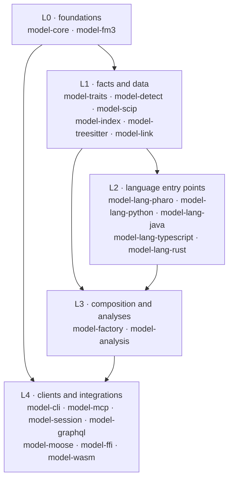
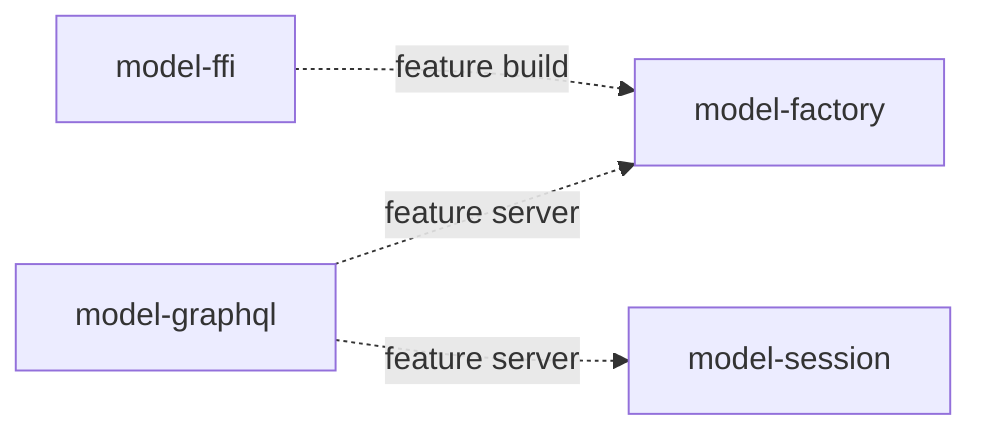

# Crate dependency map

This is the map of the `model-*` crates in the workspace. It answers **which
crate pulls which**; for the runtime data flow (detect → index → extract →
link), see [design.md](design.md) §4, and for API choices see
[usage.md](usage.md).

**Reading the arrows.** `A → B` means *A depends on B* (A is downstream, B is
reusable). In the tables below, all names drop the `model-` prefix.
`Normal` is compiled for the crate's default use, `Optional` is enabled by a
Cargo feature, and `Dev` is only for tests and examples.

## Layers at a glance



This is a **layering** view, not an edge list: some crates skip a layer
(`analysis → core`, `moose → fm3`, `ffi → core`), while the Moose export and the
FFI also use `model-analysis` for code metrics. The exact edges are in the
tables below. Optional and dev-only edges are deliberately left out of the
picture.



`model-graphql` enables `server` by default; `model-wasm` disables it, so the
schema alone stays WASM-compatible. `model-ffi` needs `factory` only with its
`build` feature.

## Exact edges

### Foundations

| Crate | Normal | Optional | Dev | Role |
|---|---|---|---|---|
| [model-core](../crates/model-core) | — | — | — | metamodel, keys, builder, frozen `Model` |
| [model-fm3](../crates/model-fm3) | — | — | — | typed FM3 metamodel reader (serde only) |

### Facts and data

| Crate | Normal | Optional | Dev | Role |
|---|---|---|---|---|
| [model-traits](../crates/model-traits) | core | — | fm3 | trait bits generated from FamixJava FM3 |
| [model-detect](../crates/model-detect) | core | — | — | languages, file counts, project roots |
| [model-scip](../crates/model-scip) | core | — | — | reads `index.scip` |
| [model-index](../crates/model-index) | detect, scip | — | — | runs indexers, staleness, document cache |
| [model-treesitter](../crates/model-treesitter) | core, traits | — | detect, link, scip | query-driven extraction and fragments |
| [model-link](../crates/model-link) | core, detect, scip | — | — | SCIP definitions/references onto entities |

### Language entry points

| Crate | Normal | Optional | Dev | Role |
|---|---|---|---|---|
| [model-lang-pharo](../crates/model-lang-pharo) | core, traits | — | — | direct Tonel frontend |
| [model-lang-python](../crates/model-lang-python) | core, traits | — | treesitter | HTTP endpoint enricher |
| [model-lang-java](../crates/model-lang-java) | core, traits, treesitter | — | moose | HTTP endpoint + GWT RPC enricher |
| [model-lang-typescript](../crates/model-lang-typescript) | core, traits | — | treesitter | HTTP call/endpoint enricher |
| [model-lang-rust](../crates/model-lang-rust) | core, link, scip, traits | — | — | rust-analyzer SCIP frontend |

Python and TypeScript parse with their own tree-sitter grammars and use
`model-treesitter` only in tests; Java reuses the extractor at runtime. Rust
needs `model-link` and `model-scip` because it rebuilds facts that
rust-analyzer only encodes in symbol names.

### Composition and analyses

| Crate | Normal | Optional | Dev | Role |
|---|---|---|---|---|
| [model-analysis](../crates/model-analysis) | core | — | — | structural and code metrics, degrees, cycles, unused, impact, derived relations |
| [model-factory](../crates/model-factory) | analysis, core, detect, index, lang-java, lang-pharo, lang-python, lang-rust, lang-typescript, link, scip, treesitter | — | — | facade: detect → index → extract → link |

`model-factory` is the only crate that pulls every source of facts. Clients
should depend on it rather than assembling the frontends themselves.

### Clients and integrations

| Crate | Normal | Optional | Dev | Role |
|---|---|---|---|---|
| [model-cli](../crates/model-cli) | analysis, core, factory | — | — | `model` binary, stateless JSON commands |
| [model-mcp](../crates/model-mcp) | analysis, cli, core, factory | — | — | MCP server keeping a model in memory |
| [model-session](../crates/model-session) | core, factory, traits | — | — | `require(scope, traits)`, only the needed layers |
| [model-graphql](../crates/model-graphql) | analysis, core, traits | factory, session (feature `server`, on by default) | lang-pharo, treesitter | GraphQL server / executable schema |
| [model-moose](../crates/model-moose) | core, analysis, fm3, traits | — | fm3 (duplicate), treesitter | Moose JSON import/export and diff |
| [model-ffi](../crates/model-ffi) | core, analysis | factory (feature `build`) | — | C ABI over a frozen `Model` |
| [model-wasm](../crates/model-wasm) | core, graphql (without `server`), lang-java, lang-pharo, lang-python, lang-typescript, treesitter | — | — | in-browser build + GraphQL |

Dev edges do not change what a downstream user compiles. They matter for local
tests: for instance `model-treesitter` checks its output against SCIP fixtures,
and `model-graphql` builds bundled-language fixtures with Pharo and Java
frontends.

## Which crate do I need?

| Task | Start with | Then |
|---|---|---|
| Read or query an existing `model.json` | [model-core](../crates/model-core) | [model-cli](../crates/model-cli), [model-mcp](../crates/model-mcp), [model-graphql](../crates/model-graphql) |
| Detect languages and project roots | [model-detect](../crates/model-detect) | — |
| Load an SCIP index | [model-scip](../crates/model-scip) | [model-link](../crates/model-link) |
| Run indexers and reuse cached documents | [model-index](../crates/model-index) | [model-factory](../crates/model-factory) |
| Extract entities from sources | [model-treesitter](../crates/model-treesitter) | [model-link](../crates/model-link) |
| Add language-specific facts | the matching [model-lang-*](../crates) frontend | [model-factory](../crates/model-factory) |
| Build a whole codebase | [model-factory](../crates/model-factory) | [model-session](../crates/model-session) for on-demand |
| Run generic analyses | [model-analysis](../crates/model-analysis) | re-exported as `model_factory::analysis` |
| Exchange with Moose / Famix | [model-fm3](../crates/model-fm3), [model-traits](../crates/model-traits) | [model-moose](../crates/model-moose) |
| Embed in Pharo through UFFI | [model-ffi](../crates/model-ffi) | feature `build` to build from sources; [Model-Moose-Importer](https://github.com/badetitou/Model-Moose-Importer) on the Pharo side |
| Run in a browser | [model-wasm](../crates/model-wasm) | GraphQL without the `server` feature |

## Invariants and maintenance

- `model-core` has no other `model-*` dependency; `model-fm3` neither. Language
  facts stay in data (queries, `kinds.json`) or in `model-lang-*` frontends.
- `model-traits` is the bridge between the core's opaque `TraitMask` and the
  FM3-derived trait data; Moose and the frontends meet there.
- The graph is acyclic. [`scripts/crates.sh`](../scripts/crates.sh) lists the
  twenty released crates in topological order; `model-mcp` and `model-wasm`
  are workspace members outside that list today.
- When adding an edge, update this page, keep the publish order valid, and run
  `cargo fmt --check`, `cargo clippy --workspace --all-targets -- -D warnings`
  and `cargo test --workspace`.

To check the table against the manifests (requires `jq`):

```sh
cargo metadata --format-version 1 --no-deps \
  | jq -r '.packages[] | select(.name | startswith("model-")) | .name as $p
           | .dependencies[] | select(.name | startswith("model-"))
           | "\($p) -> \(.name) [\(.kind // "normal")\(.optional | select(.) | " optional")]"'
```
